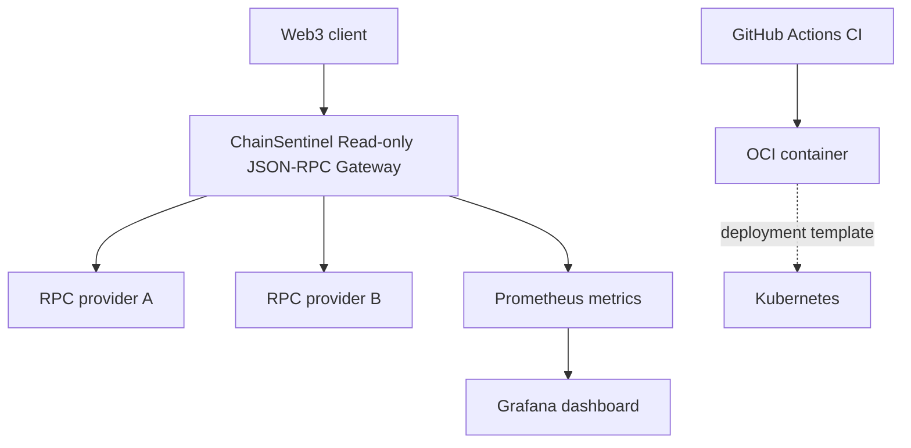

# Architecture

RPC probes call `eth_chainId` and `eth_blockNumber`. A provider is eligible only if its
chain ID is correct and its block height is within `MAX_BLOCK_LAG` of the highest
currently responding provider. The gateway prefers fresh blocks, then lower latency.
Read-only calls may fail over; transactions are *never* accepted or broadcast.

## Explicit boundaries
- This MVP is a gateway to external RPC providers, **not a full Ethereum node**.
- The `mock_rpc` containers simulate RPC responses, **not blockchain consensus**.
- Different RPC heights may reflect transient fork choice; block proximity is not finality.
- Requests are uncached. A background monitor runs every 15 seconds, but gateway calls also
  probe providers inline. Add caching and budgets for scale.
- Public production exposure needs authentication, per-tenant quotas and rate limiting.
